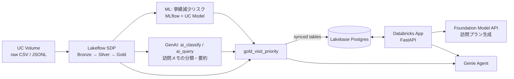

# 代理店営業の訪問準備デモ(生命保険・架空の「ひなた生命」)

> **Agency visit preparation for life insurance sales reps** — an end-to-end Databricks demo:
> Lakeflow ingestion → Unity Catalog governance → ML (sales-decline risk) + GenAI (visit-note signals, visit plans)
> → Lakebase serving & write-back → Genie Agent → Databricks App. All data is synthetic. UI and data are in Japanese.

生命保険会社の代理店営業担当が、**どの代理店に、何を持って行くか** を数分で決められるようにするデモ。
データはすべて合成データ(150代理店 / 営業担当15名 / 24か月分)。実在の会社・人物とは関係ない。



## 6つの要素と、デモで見せる場所

| 要素 | 中身 | 見せる場所 |
|---|---|---|
| **Lakeflow**(取り込み) | Volume `raw/` の CSV・JSON Lines(代理店・商品・営業担当・新契約・解約・目標・活動ログ・訪問メモ)を Auto Loader で Bronze → Silver(Expectation で不正行を除外)→ Gold | パイプライン `agency-visit-prep-pipeline` のグラフ |
| **Unity Catalog**(統制) | 全列 COMMENT、タグ(domain/layer/sensitivity=pii)、代理店連絡先の列マスク `mask_pii`、モデルも UC に登録、Bronze→Gold→同期テーブルのリネージ | `silver_agencies` の連絡先が `***`、`gold_visit_priority` のリネージタブ |
| **Lakebase**(業務向け配信) | `gold_visit_priority` / `gold_agency_monthly_kpi` を同期テーブルで Postgres へ。アプリが書く訪問プラン・訪問結果は `app_ops.visit_plans` / `visit_outcomes` | アプリの「保存された訪問プラン」、利用ログタブ |
| **ML / GenAI** | ML: 「次の3か月で挙績が20%以上落ちるか」を予測(MLflow、UC モデル `agency_decline_risk@champion`、評価は「リスク上位20社を訪問したら落ちる代理店の何割を先回りできたか」)。GenAI: 訪問メモを `ai_classify` で5分類、`ai_query` で要約、アプリで Claude が訪問プランを JSON で生成 | アプリの「リスク要因」「訪問メモ要約」「訪問プランを生成」 |
| **Genie Agent** | 訪問優先度・KPI・メモ分類などを日本語で質問 | アプリの「Genie に聞く」タブ、Genie の画面 |
| **Databricks App** | FastAPI + 静的 HTML。担当を選ぶ → 優先度リスト → 代理店の訪問準備 → AI プラン生成・保存 → 訪問後に結果を記録 | アプリ |

## デモの流れ(15分)

1. **アプリ**: 担当営業を選ぶと、担当代理店がリスクにさらされた挙績(`risk_score × 直近3か月の挙績`)の大きい順に並ぶ。
2. 1位(例: さくら保険サービス)を開く: 12か月 KPI、リスク要因(ML)、訪問メモの要約(GenAI)。**Lakebase から1代理店分をミリ秒で取得**。
3. 「訪問プランを生成」→ 現状 / リスク / 機会 / 当日確認すべき質問 / 60分のアジェンダ / 提案 / 次回アクション(約20秒)。保存すると Lakebase に書き込まれる。訪問後に結果を記録。
4. **Genie に聞く**:「今週訪問すべき代理店トップ5とその理由は？」「小林さんの担当代理店で、リスクが高いのはどこ？」「直近の訪問メモで募集人の退職や人手不足の話が出た代理店は？」(8問の確認結果は `evidence/genie_conversations.md`)
5. 裏側: パイプラインのグラフ → UC のタグ・列マスク・リネージ → MLflow の実験とモデル → Lakebase の同期テーブル。

## セットアップ

前提: Databricks CLI(OAuth でログイン済みのプロファイル)、サーバーレス・Lakebase・Foundation Model API(`databricks-claude-sonnet-4-5`)が使えるワークスペース、`jq` / `envsubst` / `psql`。
カタログ・スキーマ・Warehouse は `databricks.yml` の変数で変える(既定は `jp_fsi_catalog.agency_visit_prep`、Warehouse は名前 `Serverless Starter Warehouse` で検索)。

```bash
export PROFILE=<cli profile>
export WAREHOUSE_ID=<sql warehouse id>

# 1. パイプライン・ジョブをデプロイし、優先度リストまで作る(合成データ → Lakeflow → UC → ML/GenAI)
databricks bundle deploy -p $PROFILE
databricks bundle run agency_visit_e2e -p $PROFILE --only uc_setup,generate_raw_data,lakeflow_pipeline,uc_governance,train_risk_model,genai_visit_notes,build_visit_priority

# 2. Lakebase プロジェクトと同期テーブル(初回だけ)
scripts/setup_lakebase.sh

# 3. Genie Agent(genie/space_id.txt に ID を保存。2回目以降は更新)
python3 scripts/build_genie.py
python3 scripts/ask_genie.py           # 8問を聞いて evidence/ に保存

# 4. アプリ(リソースを付けてデプロイ)
scripts/deploy_app.sh
APP_SP=$(databricks apps get agency-visit-prep -p $PROFILE -o json | jq -r .service_principal_client_id)
#   UC: アプリ SP に USE CATALOG / USE SCHEMA / SELECT(Genie の質問はアプリ SP の権限で実行される)
#   Postgres: scripts/lb_psql.sh "GRANT SELECT ON ALL TABLES IN SCHEMA agency_visit_prep TO \"$APP_SP\";"

# 以降はジョブ全体を流せば、同期まで更新される
databricks bundle run agency_visit_e2e -p $PROFILE
```

## リポジトリの中身

| パス | 内容 |
|---|---|
| `src/01_generate_raw_data.py` | 合成データを Volume `raw/` に書く(兆候を仕込んである: 募集人の退職、設計書の減少、早期解約の苦情 など) |
| `src/pipeline/` | Lakeflow SDP(Bronze / Silver / Gold) |
| `src/02_uc_governance.py` | タグ、列マスクの確認、コメント充足率 |
| `src/03_train_risk_model.py` | ML(時系列分割、上位20社の的中率で評価、UC に登録) |
| `src/04_genai_visit_notes.sql` | `ai_classify` / `ai_query` で訪問メモを分類・要約 |
| `src/05_build_visit_priority.sql` | 訪問優先度リスト(MERGE で更新) |
| `src/06_lakebase_sync.py` | 同期テーブルの更新と Postgres の確認 |
| `app/` | Databricks App(FastAPI + 静的 HTML) |
| `scripts/` | Lakebase セットアップ、Genie の作成・確認、アプリのデプロイ |
| `evidence/` | Genie に8問聞いた結果 |

## ハマりどころ

- **`gold_visit_priority` は CREATE OR REPLACE しない。** 同期テーブル(TRIGGERED)は Change Data Feed を読むため、作り直すとスキーマ変更扱い(`DELTA_SCHEMA_CHANGED_WITH_STARTING_OPTIONS`)で同期が止まる。`05` は初回だけ CREATE、以降は MERGE。
- 同期が壊れたら、同期パイプラインは `pipelines start-update` で外から起動できない(not found)ので、同期テーブルを削除して作り直す。
- **同期テーブルを作り直すと、アプリ SP の Postgres の SELECT 権限が消える。** 表の所有者は `databricks_writer_*` で、そのロールの ALTER DEFAULT PRIVILEGES は不可。作り直したら毎回
  `scripts/lb_psql.sh 'GRANT SELECT ON ALL TABLES IN SCHEMA agency_visit_prep TO "<app SP client id>";'`
- ワークスペースによってはサーバーレスの起動待ちが長いことがある(Warehouse 約4分、同期パイプライン約10分、ジョブのノートブックタスクは20分以上のことも)。デモの前に温めておく。
